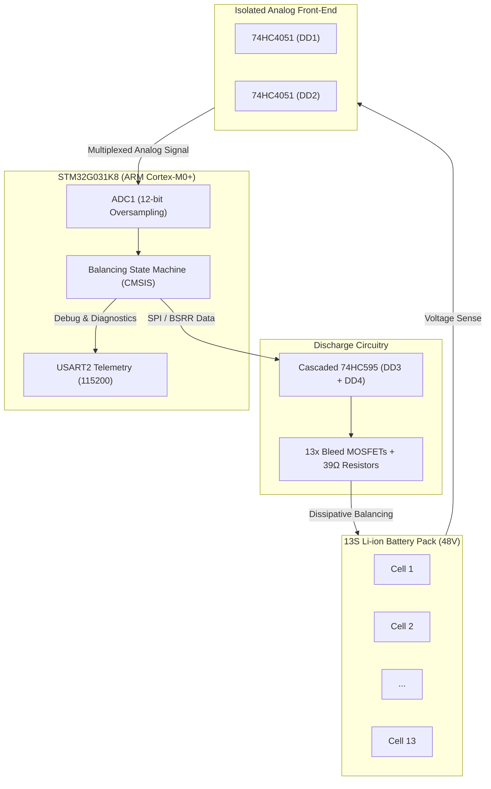

# 13S Li-ion Battery Management & Balancing System (STM32G031 CMSIS)

[](https://www.st.com/en/microcontrollers-microprocessors/stm32g031k8.html)
[]()
[]()
[]()

Production-ready, lightweight bare-metal firmware written in pure **CMSIS** (direct register manipulation, no HAL overhead) for a 13-channel Battery Management System (BMS) with passive dissipative balancing.

---

## 📌 Features

- **Bare-metal CMSIS Architecture:** Direct hardware register access for minimal flash footprint, deterministic timing, and high execution speed.
- **13-Channel Cell Voltage Acquisition:**
  - Dual 8-channel analog multiplexers (`74HC4051` DD1 & DD2).
  - High-precision 12-bit ADC with multi-sample averaging and per-cell slope/offset linear calibration.
- **Cascaded Shift Register Driver:**
  - Dual cascaded 16-bit shift registers (`74HC595` DD3 & DD4) controlled via atomic `GPIO->BSRR` bit-banging.
  - Bits `0..12`: Control gates for individual cell bleed MOSFETs.
  - Bits `13..14`: Active-low multiplexer enable lines (`EN_DD1`, `EN_DD2`).
- **Time-Sliced Top-Balancing Algorithm:**
  - **Relaxation Phase:** Discharge keys are deactivated before ADC measurement to eliminate $I_{bal} \cdot R_{wire}$ harness voltage drop errors.
  - **Measurement Phase:** High-speed scanning across all 13 cells.
  - **Balancing Phase:** Selective activation of discharge resistors for cells exceeding $V_{min} + \Delta V_{threshold}$.
  - **Fault Protection:** Automatic exclusion of disconnected or defective cells ($V_{cell} < 2.80\text{V}$ or $V_{cell} > 4.35\text{V}$).
- **Real-Time Telemetry:** Fast non-blocking telemetry stream over `USART2` (115200 baud) displaying per-cell voltages, $V_{min}$, and delta.

---

## 🏗 System Architecture



---

## 📋 Pinout & Hardware Mapping

| Signal | MCU Pin | Description |
| :--- | :--- | :--- |
| `SH_DATA` | `GPIOA` | 74HC595 Serial Data Input (DS) |
| `SH_CLK` | `GPIOA` | 74HC595 Shift Clock (SHCP) |
| `SH_RCLK` | `GPIOA` | 74HC595 Latch / Storage Clock (STCP) |
| `MUX_S0` | `GPIOB4` | 74HC4051 Address Line S0 |
| `MUX_S1` | `GPIOB5` | 74HC4051 Address Line S1 |
| `MUX_S2` | `GPIOB6` | 74HC4051 Address Line S2 |
| `ADC1_IN` | `GPIOA` | Analog voltage measurement input |
| `USART2_TX` | `PA2` | Telemetry output (115200 8N1) |
| `USART2_RX` | `PA3` | Telemetry command input |

---

## 📁 Project Structure

```text
├── Inc/
│   ├── adc.h             # ADC configuration & calibration header
│   ├── bms_balance.h     # Balancing FSM parameters & threshold definitions
│   ├── bms_measure.h     # Cell mapping & calibration structures
│   ├── init.h            # System clock (RCC) & peripheral init
│   ├── shift_register.h  # 74HC595 fast GPIO BSRR driver
│   ├── tim.h             # Hardware timer delays (TIM2/TIM3)
│   └── usart.h           # USART2 driver & packet formatting
├── Src/
│   ├── adc.c             # ADC driver (registers only)
│   ├── bms_balance.c     # Top-balancing control loop & FSM
│   ├── bms_measure.c     # Multi-channel cell sampling & conversion
│   ├── init.c            # RCC clock tree setup (64 MHz HSI/PLL)
│   ├── main.c            # Application entry point
│   ├── shift_register.c  # Shift register communication routines
│   ├── tim.c             # Microsecond/millisecond hardware delay timer
│   └── usart.c           # High-speed telemetry transmission routines
├── Startup/              # Cortex-M0+ startup vector table
└── STM32G031K8TX_FLASH.ld# Linker script for STM32G031K8Tx (64 KB Flash, 8 KB RAM)
```

---

## 🚀 Building & Flashing

### Requirements
- **Toolchain:** `arm-none-eabi-gcc` or **STM32CubeIDE**
- **Debugger:** ST-Link V2 / V3

### In STM32CubeIDE:
1. Open STM32CubeIDE.
2. Select **File -> Import... -> General -> Existing Projects into Workspace**.
3. Choose the project directory and click **Finish**.
4. Press **Build (Ctrl+B)** and flash via ST-Link (**Run / Debug**).

---

## 📄 License
This project is licensed under the MIT License.
